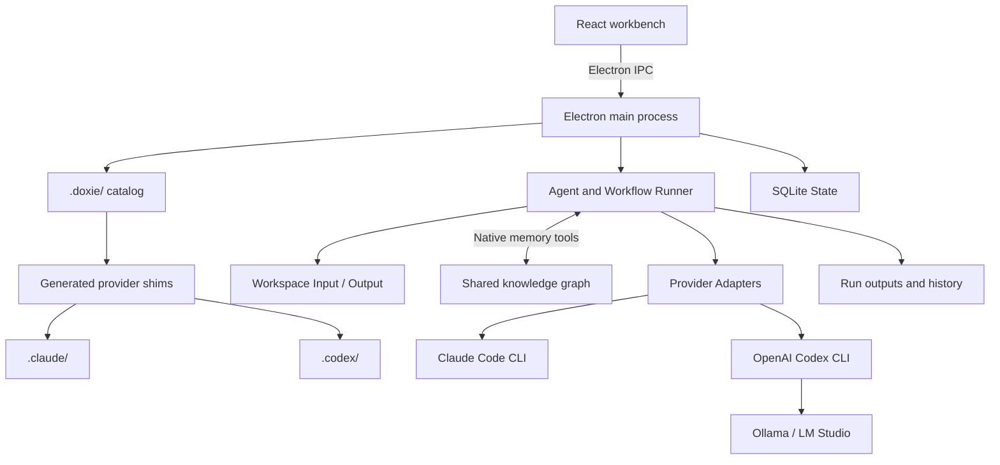

<p align="center">
  
</p>

# DoxieOS 2.1

[](https://github.com/viamus/DoxieOS/actions/workflows/ci.yml)
[](docs/release-notes/v2.1.0.md)
[](https://www.electronjs.org/)
[](LICENSE)

DoxieOS is a local desktop workbench for AI-assisted engineering. Create and
edit agents, connect them into workflows, and follow their work from one
Electron application built with Node.js and React.

Bring your project folders, reusable knowledge, and installed AI providers.
DoxieOS keeps the catalog, execution history, conversations, and artifacts on
your machine. Provider requests go to the cloud or local model you select.

## What's new in 2.1

Version 2.1 makes the library a shared knowledge base with search, a visible
memory graph, provenance, revisions, and typed learned parameters. Agents and
workflows use it independently of their input/output workspace. The desktop
workbench, workflow engine, SQLite storage, and terminals run together in Electron.

| Area | Desktop experience |
| --- | --- |
| Workbench | React navigation for workspaces, consoles, agents, connectors, workflows, libraries, and history, with native folder access. |
| Agent-owned library | Inspect knowledge, provenance, relationships, revisions and parameters learned autonomously by the harness. Existing Codex and Claude Code memories are synchronized in the background. |
| Semantic retrieval | Enable a local multilingual embedding model to search by meaning. Text search works immediately without a model download. |
| Agent editing | Edit instructions, metadata, provider, model, and reasoning effort directly. Ordinary runs use the agent's saved execution settings. |
| AI builders | Create agents and workflows through conversations, preview drafts, and save them to the catalog. Resume saved sessions after navigation or restart. |
| Run results | Read the final response as Markdown, including tables and links. Expand Activity, Diagnostics, or Full log for execution details. |
| Questions and alerts | Agents pause for your clarification, then continue with your answer. Native Windows alerts open the source run or builder conversation. |
| Context efficiency | Compact requests and bounded builder history reduce repeated text. Required instructions stay whole, with optional memories available on demand. |
| Providers | Discover models from installed providers, share the installed Codex CLI's ChatGPT sign-in, and configure MCP servers in Settings. |
| Voice input | Dictate locally with Whisper Tiny on the CPU and review the transcript before sending. The first use downloads the model. |
| Packaging | Run a portable Windows app with an embedded Electron and Node.js runtime. |

See the [2.1 release notes](docs/release-notes/v2.1.0.md),
[library guide](docs/library-memory.md), and [upgrade guide](docs/operations.md#upgrade-from-20).

## Start on Windows

1. Download the `DoxieOS-win32-x64` artifact from a successful [Electron CI run](https://github.com/viamus/DoxieOS/actions/workflows/ci.yml) that includes version 2.1.
2. Extract the artifact and the enclosed `DoxieOS-win32-x64.zip`. Keep the application folder and its resources together.
3. Open `run.bat` or `DoxieOS.exe` inside the extracted application folder.
4. In **Settings → Agent CLI providers**, configure and authenticate an installed provider.

The Windows package includes Electron and Node.js. Install the provider CLI
you want to use separately. Application data lives in `%APPDATA%\doxieos`,
including the managed workbench, provider profiles, and SQLite history.

## Choose a provider

| Provider | Setup |
| --- | --- |
| OpenAI Codex | Install the Codex CLI and authenticate from Settings. Cloud runs share the installed CLI's ChatGPT sign-in by default. |
| Claude Code | Install the Claude Code CLI and authenticate from Settings using the profile managed by DoxieOS. |
| Ollama / LM Studio | Install the Codex CLI, start your local model server, and select an exposed model. Workflow agents need a model with tool support. |

Model selectors discover the installed providers' inventory. Agents save their
execution preferences; connectors and workflow nodes can override them. MCP
servers are configured in **Settings** and must be available when a provider
uses them. See [provider setup](docs/operations.md#providers-and-mcp) for details.

## Work with agents and workflows

1. Create a **Workspace** for input and output files. Choosing an existing project folder copies its files into the managed workspace. Put manual Markdown there and use **Workspace Memory** to supply it explicitly to an execution.
2. Choose a catalog agent, edit it directly, or select **Build agent**, choose the session settings, and select **Start session**. Review the AI builder's draft and select **Save to catalog**.
3. Run the agent with its saved settings and inspect its response, artifacts, and history. Use **Consoles** for interactive provider sessions.
4. Use the visual **Workflow** editor or AI builder to connect agents and native connectors for approvals, conditions, loops, aggregation, and workspace output.

Workflow edges carry transient context and isolated copies of declared
artifacts. Workspaces keep durable input and output files. The harness maintains
one shared **Library** autonomously; its page is for inspection, not manual
knowledge registration. Run workflows manually
or on enabled cron schedules while the app is open; cron uses UTC. Event and
webhook definitions are retained for compatibility and do not trigger runs.

Agents, workflows, and workspaces support ZIP transfer.
The central knowledge database and optional semantic model live in the app profile.
Learn more in [concepts](docs/concepts.md) and the
[authoring guide](docs/authoring-agents-and-workflows.md).

## Upgrade from 1.x

1. Close DoxieOS 1.x and launch the desktop app. On first setup, it copies a snapshot of a detected legacy SQLite database if a desktop database does not exist yet.
2. Select **File → Import workbench…** and choose your old workbench folder to copy its catalog and workspace files into the desktop profile.
3. Check storage paths in **Settings**, then authenticate each provider you use.

The desktop app also reads 1.x ZIP transfer archives. See the
[upgrade guide](docs/operations.md#upgrade-from-doxieos-1x) for data paths and
import behavior.

## Architecture At A Glance



DoxieOS owns the canonical `.doxie/` catalog and generates provider
compatibility files from it. Catalog assets stay independent of the provider
used to execute them.

## Develop Locally

Install Node.js 22.17 or newer and npm. From the repository root, install the
locked dependencies, verify them, and launch the workbench.

```bash
node tools/check-dependencies.mjs
npm ci --ignore-scripts
npm audit signatures
npm audit --audit-level=high
npm rebuild electron node-pty --ignore-scripts=false
node node_modules/electron/install.js
npm start
```

`npm start` builds the React renderer and launches Electron. On Windows, the
repository's `run.bat` opens an available package or starts the prepared local
development setup.

| Command | Purpose |
| --- | --- |
| `npm run build` | Build the React renderer with Vite. |
| `npm test` | Run Node tests using temporary databases and workbenches. |
| `npm run test:desktop` | Build and run Playwright integration tests against Electron. |
| `npm run package` | Build an unsigned desktop bundle for the host platform; Windows also produces a portable ZIP. |

Electron tests require a graphical session; use Xvfb on headless Linux.
[Electron CI](.github/workflows/ci.yml) runs on Windows and Linux, verifies
dependency sources, integrity and signatures, audits vulnerabilities, and runs
the Node and desktop tests. Windows CI also packages the app, tests the
packaged executable, and uploads the portable ZIP.

## Repository Shape

```text
.
├── .doxie/                         # Canonical Doxie catalog
├── docs/                           # Product documentation
├── src/desktop/                    # Electron main process and Node runtime
├── src/renderer/                   # React workbench
├── tests/                          # Node and Electron tests
├── run.bat                         # Windows launcher
├── LICENSE                         # Apache License 2.0
└── NOTICE                          # Attribution notice for redistributions
```

The repository's `.doxie/` directory supplies the bundled catalog. Active
catalogs, workspaces and runtime state live in Electron's user data directory.

## Documentation

Start with the [documentation index](docs/README.md).

- [Concepts](docs/concepts.md)
- [Architecture](docs/architecture.md)
- [Central library and memory graph](docs/library-memory.md)
- [Authoring Agents And Workflows](docs/authoring-agents-and-workflows.md)
- [Operations Guide](docs/operations.md)
- [Release History](docs/release-notes/README.md)
- [Licensing And Attribution](docs/licensing.md)

## License

DoxieOS is licensed under the [Apache License 2.0](LICENSE) and ships with a
[NOTICE](NOTICE) file. The license keeps DoxieOS free to use while preserving
attribution and patent protections.

See [Licensing And Attribution](docs/licensing.md) for the project intent.

## Contributing

See [CONTRIBUTING.md](CONTRIBUTING.md) for setup, branch naming, review
conventions, and code style.

Quick version:

1. Branch from `main`.
2. Keep product/runtime changes separate from catalog/spec-only changes.
3. Edit canonical Doxie files under `.doxie/` when changing agents or workflows.
4. Run the narrowest useful validation locally.
5. Push and open a reviewable change.
