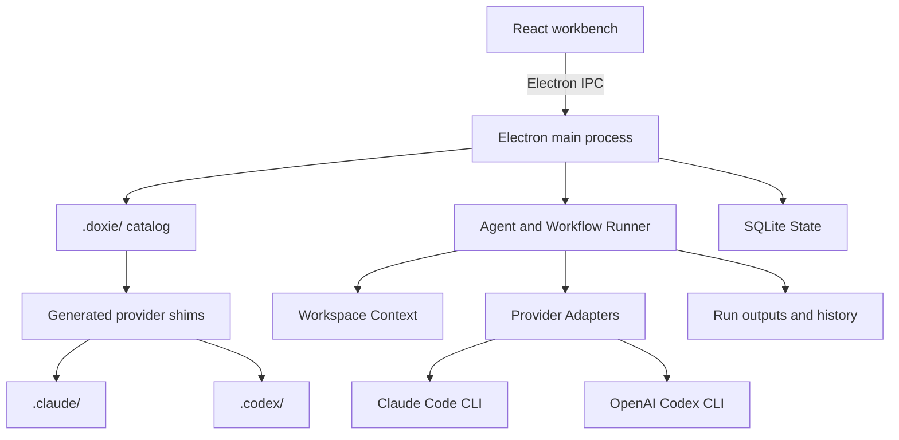

<p align="center">
  
</p>

# DoxieOS

[](https://github.com/viamus/DoxieOS/actions/workflows/ci.yml)
[](https://www.electronjs.org/)
[](LICENSE)

DoxieOS is a local desktop workbench for AI-assisted engineering. Agents,
workflows, workspaces, reusable memory, live consoles, and run history share
one Electron application built with Node.js and React.

Claude Code and OpenAI Codex are supported provider CLIs, but they are not the
product boundary. DoxieOS owns the canonical `.doxie/` catalog and emits
provider-specific compatibility files from that source of truth.

## What You Get

- A desktop workbench for launching, observing, and reviewing agent work.
- A canonical `.doxie/` catalog for agents, workflows, libraries, and memories.
- Provider-neutral execution for Claude Code, OpenAI Codex, and future CLI-backed providers.
- Workspace-aware memory mounting for project standards and team context.
- Workflow orchestration for repeatable multi-agent delivery.
- Transient context across workflow edges and native operations for approval, loops, and libraries.
- Model selection by agent and by workflow node.
- Agent and workflow builders with draft previews and catalog promotion.
- Live consoles, run history, usage tracking, release notes, and notifications.
- MCP-aware settings for Claude/Codex config reconciliation.
- ZIP transfer for agents, workflows, workspaces, and libraries.

## Documentation

The full product documentation lives in [docs/](docs/README.md).

- [Concepts](docs/concepts.md)
- [Architecture](docs/architecture.md)
- [Authoring Agents And Workflows](docs/authoring-agents-and-workflows.md)
- [Operations Guide](docs/operations.md)
- [Release History](docs/release-notes/README.md)
- [Licensing And Attribution](docs/licensing.md)

## Architecture At A Glance



## Launch on Windows

Extract `DoxieOS-win32-x64.zip` and double-click `run.bat` in the extracted
folder. You can also open `DoxieOS.exe` directly. DoxieOS stores your workbench,
settings and run history in `%APPDATA%\doxieos`.

## Develop Locally

Install Node.js 22.17 or newer and npm. From the repository root, install the
locked dependencies, verify them, and launch the workbench.

```bash
node tools/check-dependencies.mjs
npm ci --ignore-scripts
npm audit signatures
npm audit --audit-level=high
npm rebuild electron node-pty --ignore-scripts=false
node node_modules/electron/install.js
npm start
```

On Windows, `run.bat` at the repository root opens the packaged app when
available or starts the local development setup after you have installed the
dependencies. Sign in to your installed Claude Code or OpenAI Codex CLI from
**Settings** to use provider-backed actions.

Use `npm test` for Node tests, `npm run test:desktop` for Electron integration
tests, and `npm run package` to create a desktop bundle. See the operations guide
for setup, data paths, and the upgrade from DoxieOS 1.x. [Operations guide](docs/operations.md)

## Repository Shape

```text
.
├── .doxie/                         # Canonical Doxie catalog
├── docs/                           # Product documentation
├── src/desktop/                    # Electron main process and Node runtime
├── src/renderer/                   # React workbench
├── tests/                          # Node and Electron tests
├── run.bat                         # Windows launcher
├── LICENSE                         # Apache License 2.0
└── NOTICE                          # Attribution notice for redistributions
```

The repository's `.doxie/` directory supplies the bundled catalog. Active
catalogs, workspaces and runtime state live in Electron's user data directory.

## Bundled Catalog

The bundled catalog includes:

- agent and workflow builders;
- Doxie library authoring;
- prompt, aggregate, loop, approval, and workspace output primitives;
- transient sandbox management for isolated agent scratch work.

## License

DoxieOS is licensed under the [Apache License 2.0](LICENSE) and ships with a
[NOTICE](NOTICE) file. The license keeps DoxieOS free to use while preserving
attribution and patent protections.

See [Licensing And Attribution](docs/licensing.md) for the project intent.

## Contributing

See [CONTRIBUTING.md](CONTRIBUTING.md) for setup, branch naming, review
conventions, and code style.

Quick version:

1. Branch from `main`.
2. Keep product/runtime changes separate from catalog/spec-only changes.
3. Edit canonical Doxie files under `.doxie/` when changing agents or workflows.
4. Run the narrowest useful validation locally.
5. Push and open a reviewable change.
