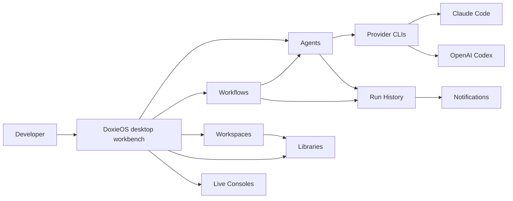

# DoxieOS Documentation

DoxieOS is a local-first operating layer for AI-assisted engineering work. It
keeps agent definitions, workflows, workspaces, libraries, provider shims, run
history, and local operational state close to the developer machine.

This folder is the product documentation entry point.

## Read First

- [Concepts](concepts.md) describes the product vocabulary and how the pieces relate.
- [Architecture](architecture.md) covers runtime boundaries, data flow, and provider compatibility.
- [Authoring Agents And Workflows](authoring-agents-and-workflows.md) explains the catalog format.
- [Operations Guide](operations.md) covers local setup, packaging, MCP, storage, and upgrades.
- [Release History](release-notes/README.md) preserves previous release notes and illustrations.
- [Public Content Guard](public-content-guard.md) describes the pre-commit checks for public contributions.
- [Licensing And Attribution](licensing.md) explains the Apache-2.0 license and NOTICE.

## Product Map



## Repository Shape

```text
.
├── .doxie/                         # Canonical Doxie catalog
│   ├── skills/<id>/
│   ├── workflows/<id>/
│   └── libraries/<id>/
├── docs/                           # Product documentation
├── src/desktop/                    # Electron main process and Node runtime
├── src/renderer/                   # React workbench
├── tests/                          # Node and Electron tests
├── LICENSE                         # Apache License 2.0
└── NOTICE                          # Attribution notice for redistributions
```

## Documentation Rules

- Keep product documentation in this folder.
- Keep release-note Markdown and illustrations under `docs/release-notes/`.
- Prefer diagrams for relationships, flows, and boundaries.
- Keep README concise and place durable explanations in `docs/`.
