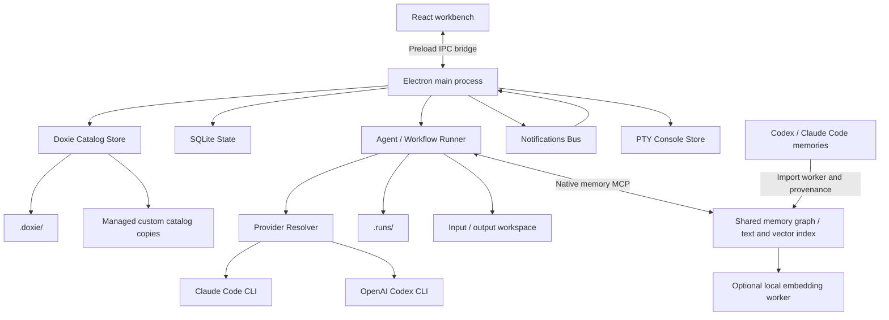
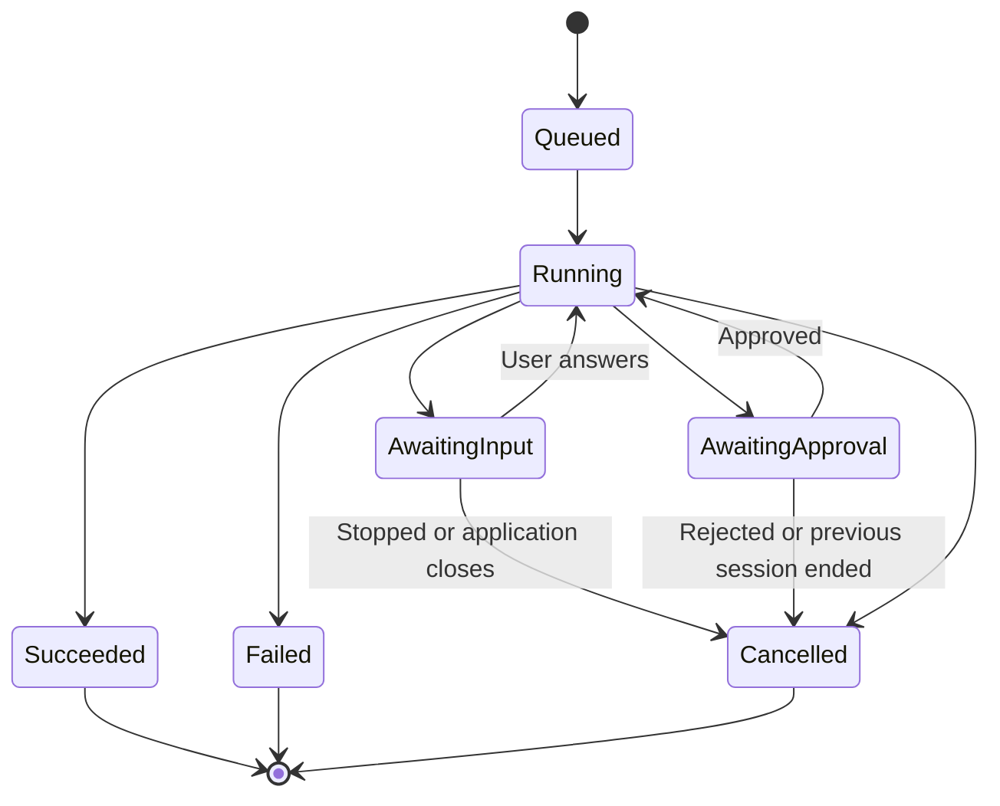
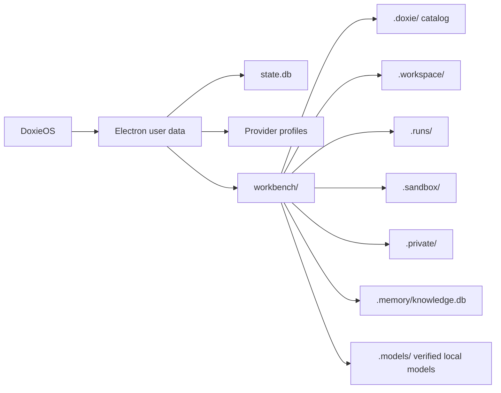
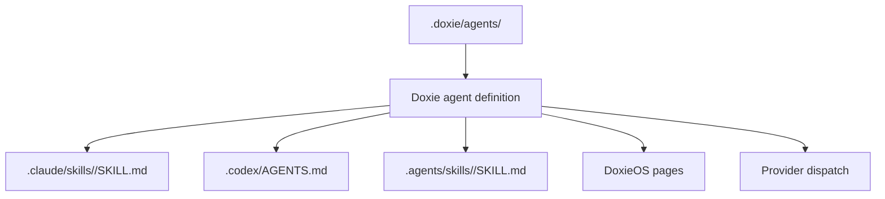

# Architecture

DoxieOS is an Electron application. React renders the workbench and the
Electron main process runs the Node.js catalog, workflow engine, SQLite state,
PTY consoles, and provider adapters.

## System Overview



## Runtime Boundaries

| Boundary | Responsibility |
| --- | --- |
| Renderer | Pages, settings, builders, history, notifications, and read-only knowledge graph inspection. |
| Preload | Named IPC operations and runtime events exposed to the renderer. |
| Main | Validates operations and owns filesystem access, SQLite, processes, and dialogs. |
| Agents | Catalog parsing, provider prompt assembly, run persistence, process lifecycle. |
| Workflows | Graph execution, selected-edge handoffs, transient context, native tools and durable artifact contracts. |
| Consoles | PTY sessions and streaming output. |
| Storage | SQLite state, catalog roots, workspaces, sandboxes, run outputs. |

## Execution Flow

```mermaid
sequenceDiagram
    participant U as Developer
    participant UI as DoxieOS UI
    participant R as Runner
    participant C as Catalog
    participant W as Workspace
    participant P as Provider CLI
    participant H as History

    U->>UI: Start agent or workflow
    UI->>R: Dispatch through Electron IPC
    R->>C: Load agent/workflow definition
    R->>W: Select input/output files; load Markdown only through explicit connector
    R->>P: Start a fresh provider session with the typed request
    P-->>R: Stream output and result metadata
    P-->>R: Publish transient context and durable artifacts
    R->>H: Persist run state, selected model, usage, logs, durable outputs
    H-->>UI: Render history/detail/notifications
```

The handoff lives for the active workflow. It carries context JSON as the
exact text published by the producer and indexes isolated artifact copies for
the consumer. The engine drops the transport at workflow end. Native tools run
inside the engine, with no model selection or provider process.

The shared library is exclusively fed by the agent harness. All model-backed
executions receive native retrieval/learning tools and autonomous learning
instructions. The UI does not expose knowledge registration or editing. A
Workspace Memory connector supplies explicit manual Markdown as transient
input; the receiving agent can record verified learnings with evidence and its
run ID. Loading Markdown does not write raw files into shared knowledge.

## Workflow Run States



Agent questions are validated JSON files from a completed provider turn.
The run remains active while waiting; the next provider turn receives the
original request and exact question/answer history under the same run ID.
Workflow node state preserves the pending question and owning agent run, so
parallel steps and loop iterations can wait independently. Native Electron
notifications bring the window to the source run when clicked.

## Storage Model



Development and packaged launches use the same storage layout. The main
process copies imported catalogs and workspace files into the workbench.
Version the source catalog when assets are part of a product or team workflow.
The runtime profile also contains local output and provider state.

## Provider Compatibility

DoxieOS emits provider compatibility files from the canonical `.doxie/` catalog.
Claude Code and Codex consume the files and the context assembled at dispatch.
Claude Code and local/API adapters use profiles managed inside Electron user
data. Cloud Codex shares the installed CLI's ChatGPT credentials by default,
while headless invocations ignore installed user configuration and receive
DoxieOS's MCP registry explicitly. Sign-in from Settings uses the same
authentication profile as agent runs and consoles.



## Release Notes

Previous release notes and illustrations are available in the [release history](release-notes/README.md).
