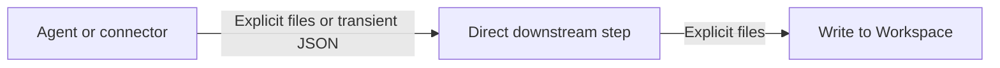

# Authoring agents and workflows

## Agents

Create one directory per agent under `.doxie/agents/<id>/`. Use a kebab-case ID. Put metadata and modes in `manifest.json`, operating instructions in `body.md`, and optional reusable agent context under `memories/`. An optional `agent.md` defines a provider-specific Claude subagent adapter.

```json
{
  "id": "review-report",
  "displayName": "Review Report",
  "description": "Extracts release blockers from a review report.",
  "modes": {
    "inspect": {
      "description": "Extract release blockers.",
      "fields": [{ "id": "report", "label": "Report path", "required": true }]
    }
  }
}
```

Describe the agent's responsibility, explicit inputs, and output contract. Declare real tool, environment, or MCP prerequisites. Use `execution` to set an explicit provider and optionally a model. The generated provider skills consume the same agent definition.

DoxieOS reads legacy `.doxie/skills/<id>/` definitions and accepts existing catalog archives. New or edited agents use the current `.doxie/agents/<id>/` layout.

## Workflow graphs

Store a definition in `.doxie/workflows/<id>/workflow.json`. Use `Agent` nodes to invoke a Doxie agent and `Tool` nodes for workflow connectors. An edge makes the producer's handoff available to the direct consumer.

```json
{
  "id": "release-brief",
  "name": "Release Brief",
  "trigger": { "kind": "manual", "inputs": [{ "id": "notes", "label": "Notes", "required": true }] },
  "nodes": [
    {
      "id": "summarize", "kind": "Tool", "toolId": "prompt", "toolMode": "run",
      "inputs": { "prompt": "Prepare a release brief.", "input_text": "{{trigger.notes}}", "output_format": "md" }
    },
    {
      "id": "deliver", "kind": "Tool", "toolId": "write-to-workspace", "toolMode": "deliver",
      "inputs": { "workspace": "release", "filename": "release-brief.md" }
    }
  ],
  "edges": [{ "fromNodeId": "summarize", "toNodeId": "deliver" }]
}
```

Set a model-backed node's `execution` to override the provider selection for that step. A model belongs to an explicitly selected provider.

| Connector | Purpose |
| --- | --- |
| `aggregate` | Merge text artifacts from direct upstream nodes. |
| `approval-gate` | Pause for an operator decision. |
| `if-else` | Evaluate upstream JSON and select the `true` or `false` edge. |
| `library` | Create a library from selected material or mount an existing library into a workspace. |
| `loop` | Run a subgraph for each item of an upstream JSON array. |
| `prompt` | Invoke a model for a focused transformation on declared inputs. |
| `sandbox` | Allocate and list temporary run-owned folders. |
| `write-to-workspace` | Deliver an explicit Markdown artifact to a selected workspace. |

Older workflows that use a connector's ID as an `agentId` still resolve to that connector. Use `toolId` and `toolMode` in new workflows.

## Context and artifacts

Each model-backed step starts a fresh provider request. DoxieOS supplies a `doxie.agent-request.v1` object through the provider's stdin request. It includes the step's mode, its explicit `inputs`, and an optional `handoff` object for the workflow. Use native Loop or Cron for repetition.

The `doxie.workflow-handoff.v1` handoff identifies the workflow, run, and node. For a loop it identifies the iteration. Its `sources` list describes direct upstream nodes and the current loop item, with each source's artifact directory, relative paths, media types, sizes, and optional `contextJson` text. A native tool that forwards context includes `forwardedContexts` with the original producer's node, iteration, and JSON text. Artifact directories are scoped snapshots and last only for the consumer's step.

- Write an explicit output file under `DOXIE_WORKFLOW_OUTPUT_DIR` or `DOXIE_AGENT_OUTPUT_DIR` for a file deliverable. The workflow reads declared files from the node output. An optional `.doxie-artifact.json` can specify the intended files.
- Write a JSON object of at most 64 KiB to `DOXIE_WORKFLOW_CONTEXT_OUT` when the next step only needs structured context. The runtime supplies that value as `contextJson` to direct consumers for this execution. The total context budget is 512 KiB per run.
- Add a Write to Workspace node when a result should be delivered to a workspace. Its input edge identifies the files to deliver.



Transient context is available while the run is active. A rerun that needs it may need to restart at its producing step. The run history records execution and artifact metadata.

## Builders

Agent Builder and Workflow Builder co-author drafts with the user in an isolated builder sandbox. The workbench previews `.draft/manifest.json`. Selecting **Save** validates and promotes the draft into the chosen catalog. The workflow builder can place draft agent dependencies under `.draft/new-agents/`.

The workbench keeps the builder transcript with its draft and supplies recent turns explicitly to each fresh model request. The draft keeps older turns available when the active request omits them.
