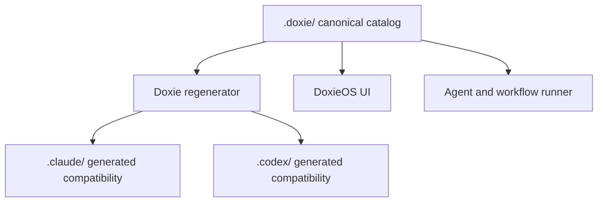
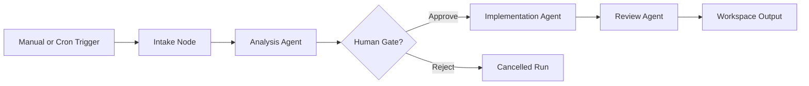
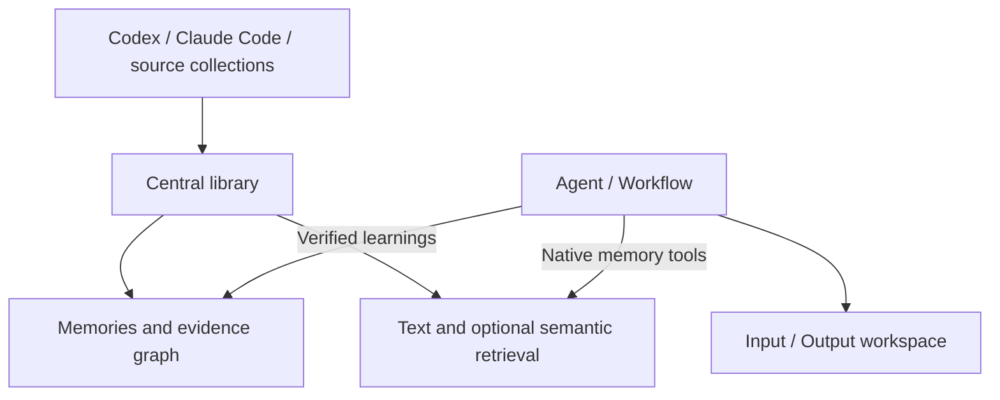

# Concepts

DoxieOS is built around a small set of durable concepts. The UI can evolve, but
these concepts define the product model.

## Core Objects

| Concept | What It Means | Stored In |
| --- | --- | --- |
| Agent | A model-driven unit of work with instructions, inputs, an optional execution preference, and an output contract. | `.doxie/agents/<id>/` |
| Connector | A built-in operation such as Approval, Loop, Aggregate, Library, or the model-backed Prompt. | `.doxie/tools/<id>/` |
| Workflow | A graph of agent and connector nodes with explicit dependencies. | `.doxie/workflows/<id>/workflow.json` |
| Library | Shared memories, entities, evidence relationships, and learned parameters, with optional source collections. | `.memory/knowledge.db`; source collections under `.doxie/libraries/<id>/` |
| Workspace | A persistent input/output folder selected for an agent, workflow, or console execution. | `.workspace/` by default |
| Catalog | A root folder containing Doxie agents, workflows, and libraries. | `.doxie/` or custom catalog folders |
| Provider | A CLI-backed execution target such as Claude Code or OpenAI Codex. | App settings and provider config |
| Run | A persisted execution record for an agent or workflow. | SQLite state and run output folders |

## Canonical Versus Generated

`.doxie/` is the source of truth. Provider-specific folders are compatibility
outputs so current CLIs can consume Doxie-authored assets.

## Agents

An agent is the smallest reusable unit of Doxie work. It should define:

- what the agent is responsible for;
- what inputs it accepts;
- which tools or external systems it needs;
- what output another human or workflow node can consume;
- when it should stop and ask for help.

Agents can be advisory, implementation-oriented, or focused on transforming a
payload. Each ordinary execution starts in a fresh provider session. A model
preference can be attached to an agent and overridden for a single run or a
workflow node.

## Workflows

A workflow is a graph. It can run manually, on cron, or from persisted trigger
definitions that will be wired later.

Edges select which upstream results a node receives. Doxie passes transient
context and isolated copies of declared artifacts from those predecessors.
The provider's diagnostic output belongs to run history. Agents publish
business outputs explicitly as transient context, durable artifacts, or both.

## Workspaces

Workspaces contain input files, generated outputs, and handoff artifacts.
Choose the workspace when running an agent, workflow, or console. Agents and
libraries are not mounted to it. DoxieOS does not inject `WORKSPACE.md` or
workspace memory folders into model requests. Existing files remain available
as inputs, and manually authored provider instruction files remain owned by
their author.

## Libraries

The library is a central knowledge base owned exclusively by the agent harness.
Its interface is for inspection, without manual registration. Memories describe verified facts,
entities, or typed parameters. Evidence relationships connect supporting,
conflicting, related, and superseding records. Source paths, providers and run
IDs retain provenance; revision history remains available after updates.

All model executions can record verified learnings autonomously. Manual
Markdown files stay in a workspace and enter an execution through the native
Workspace Memory connector. Loading them does not directly register library
knowledge.

Learning adds knowledge records and relationships; it does not train or change
the provider's model weights. See the [library guide](library-memory.md).

## Providers

DoxieOS is provider-neutral. It prepares the run context and dispatches to the
selected provider CLI. Provider compatibility is intentionally an adapter layer,
not the product model.

Claude Code and OpenAI Codex execute through their installed CLIs. Local
models exposed by Ollama or LM Studio run through the Codex CLI's Responses
client.
